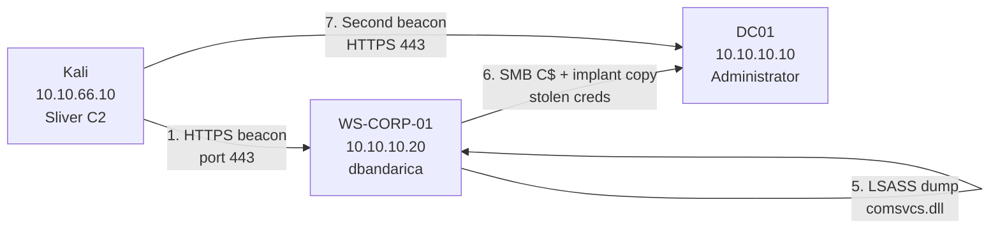

# Phase 4 — Attack Scenarios (Part 2: Insider with Local Admin — C2 to Domain Compromise)
 
## Overview
 
This scenario is the second end-to-end attack executed against the lab. It exercises a complete kill chain against the corporate Windows environment and Active Directory domain, from initial execution on a domain-joined workstation to full compromise of the Domain Controller. The scenario chains seven discrete phases — execution, command and control, attempted privilege escalation, discovery, credential access, lateral movement, and domain compromise, each producing observable telemetry in Wazuh and each observed in the SIEM before proceeding to the next.
 
The narrative arc models a realistic insider threat pattern: a developer with local administrator privileges on their workstation (`dbandarica`, granted via GPO as is common in small and medium enterprises) executes a malicious payload delivered through a simulated phishing vector. The payload establishes a command-and-control beacon over HTTPS to external attacker infrastructure. From that beacon, the attacker enumerates the domain, dumps credentials from memory, pivots to the Domain Controller using stolen credentials, and demonstrates full control of the Active Directory domain — all without touching a keyboard on any compromised host.
 
Unlike Scenario 1 (Linux, VLAN Dev, brute force entry), this scenario operates entirely in the Windows/Active Directory environment (VLAN Corp) and uses a modern C2 framework (Sliver) with HTTPS transport. The change in terrain is deliberate: it demonstrates detection engineering across both Linux and Windows.
 
The scenario also surfaces three defensive findings that are as valuable as the attack itself: Microsoft's patching of UAC bypass techniques in Windows 11 24H2, LSA Protection (PPL) blocking LSASS credential dumping by default, and Wazuh's tendency to over-map built-in rules to MITRE tactics — producing misleading tactic counts that require analyst judgment to interpret correctly.
 
---
 
## MITRE ATT&CK coverage
 
The scenario exercises 12 techniques across 7 tactics:
 
| Tactic | Technique | Sub-technique / description | Phase |
| ------ | --------- | --------------------------- | ----- |
| Execution | T1204.002 | User Execution: Malicious File | 1 |
| Command and Control | T1071.001 | Application Layer Protocol: Web Protocols (HTTPS) | 2 |
| Command and Control | T1573 | Encrypted Channel | 2 |
| Command and Control | T1105 | Ingress Tool Transfer | 1, 6 |
| Defense Evasion | T1548.002 | Abuse Elevation Control Mechanism: Bypass UAC (attempted, failed) | 3 |
| Discovery | T1082 | System Information Discovery | 4 |
| Discovery | T1087.002 | Account Discovery: Domain Account | 4 |
| Discovery | T1016 | System Network Configuration Discovery | 4 |
| Discovery | T1018 | Remote System Discovery | 4 |
| Credential Access | T1003.001 | OS Credential Dumping: LSASS Memory | 5 |
| Lateral Movement | T1021.002 | Remote Services: SMB/Windows Admin Shares | 6 |
| Persistence | T1136.002 | Create Account: Domain Account (demonstrated, then removed) | 7 |
 
---
 
## Attack chain
 

 
---
 
## Environment Preparation
 
### Threat model — insider with local admin
 
The scenario models a threat vector that dominates small and medium enterprise incidents: a domain user with local administrator privileges on their own workstation. This is not a misconfiguration introduced for the lab, it is a deliberate modelling decision reflecting the reality that many organisations grant local admin to developers, power users, or employees who need to install software without involving IT support.

### C2 infrastructure
 
The Sliver C2 framework (v1.7.3) was deployed on Kali (10.10.66.10, VLAN 66 Adversary DMZ). An HTTPS listener was configured on port 443, and a beacon-mode implant was generated for Windows x64 with 60-second callback interval and 30% jitter.
 
| Parameter | Value |
| --------- | ----- |
| Framework | Sliver v1.7.3 |
| Transport | HTTPS (port 443) |
| Mode | Beacon (async) |
| Interval | 60 seconds |
| Jitter | 30% |
| Architecture | windows/amd64 |
| Format | .exe |
| Implant name | SELECTIVE_DISCONNECTION.exe |
| Size | ~36 MB |
 
The implant was served from Kali via a Python HTTP server on port 80, downloaded to WS-CORP-01 via `Invoke-WebRequest`, and renamed to `update.exe` in the user's Downloads folder — modelling a payload disguised as a legitimate software update.
 
### Snapshots
 
WS-CORP-01 and DC01 were snapshotted as `pre-scenario2-insider` before execution, enabling rapid reset after the scenario.
 
---

## Phase 1 — Execution (T1204.002)
 
### Objective
 
Model the initial execution of a malicious payload on WS-CORP-01. In the scenario narrative, `dbandarica` has received a phishing email with a malicious attachment, downloads it, and executes it from an elevated PowerShell session (because "it needs admin to install").
 
### Execution
 
The payload was downloaded from the attacker's HTTP server and executed from an elevated PowerShell session:
 

 
The process started silently in the background, no visible window, no console output, consistent with how a modern implant behaves.
 
### Wazuh detection
 
The execution phase generated 139 alerts in Wazuh within 20 minutes, concentrated in two spikes corresponding to the two execution attempts (Defender block, then successful execution).

 
**Primary detection — Rule 92213 (level 15):**
 
Wazuh's built-in Sysmon rule 92213 fired immediately upon the implant being written to disk, detecting the executable drop in a folder classified as "commonly used by malware" (the user's Downloads directory):
 
- **Rule ID:** 92213
- **Level:** 15 (attack — highest built-in severity)
- **MITRE:** T1105 — Ingress Tool Transfer
- **Tactic:** Command and Control
- **Groups:** sysmon, sysmon_eid11_detections, windows
This is the single highest-severity detection of the entire scenario, and it fired on a built-in rule without any custom engineering.

 
**Secondary detection — Rule 61638 (level 12):**
 
Sysmon flagged `dllhost.exe` (COM Surrogate) as a suspicious process during the PowerShell elevation:
 
- **Rule ID:** 61638
- **Level:** 12
- **MITRE:** T1055 — Process Injection
- **Tactic:** Defense Evasion, Privilege Escalation
This detection illustrates an important operational nuance: the `dllhost.exe` activity was triggered by the legitimate UAC elevation (PowerShell "Run as Administrator"), not by an attack. The same COM pattern is used by UAC bypass techniques, so Wazuh flags it regardless of intent. This is a true positive by pattern but a false positive by context — the kind of alert an L1 analyst must learn to triage.

 
---

 
The local admin privilege was provisioned through a Group Policy Object (`GPO_Workstation_LocalAdmins`) that adds the domain group `WorkstationAdmins` to the local `Administradores` group on domain workstations via Restricted Groups. The user `dbandarica` was added to `WorkstationAdmins` in Active Directory. This mirrors the standard corporate pattern: membership in a domain group controls local admin on workstations, managed centrally rather than per-host.
