# Phase 4 — Attack Scenarios (Part 2: Insider with Local Admin — C2 to Domain Compromise)
 
## Overview
 
This scenario is the second end-to-end attack executed against the lab. It exercises a complete kill chain against the corporate Windows environment and Active Directory domain, from initial execution on a domain-joined workstation to full compromise of the Domain Controller. The scenario chains seven discrete phases — execution, command and control, attempted privilege escalation, discovery, credential access, lateral movement, and domain compromise, each producing observable telemetry in Wazuh and each observed in the SIEM before proceeding to the next.
 
The narrative arc models a realistic insider threat pattern: a developer with local administrator privileges on their workstation (`dbandarica`, granted via GPO as is common in small and medium enterprises) executes a malicious payload delivered through a simulated phishing vector. The payload establishes a command-and-control beacon over HTTPS to external attacker infrastructure. From that beacon, the attacker enumerates the domain, dumps credentials from memory, pivots to the Domain Controller using stolen credentials, and demonstrates full control of the Active Directory domain — all without touching a keyboard on any compromised host.
 
Unlike Scenario 1 (Linux, VLAN Dev, brute force entry), this scenario operates entirely in the Windows/Active Directory environment (VLAN Corp) and uses a modern C2 framework (Sliver) with HTTPS transport. The change in terrain is deliberate: it demonstrates detection engineering across both Linux and Windows.
 
The scenario also surfaces three defensive findings that are as valuable as the attack itself: Microsoft's patching of UAC bypass techniques in Windows 11 24H2, LSA Protection (PPL) blocking LSASS credential dumping by default, and Wazuh's tendency to over-map built-in rules to MITRE tactics — producing misleading tactic counts that require analyst judgment to interpret correctly.
 
---
 
## MITRE ATT&CK coverage
 
The scenario exercises 12 techniques across 7 tactics:
 
| Tactic | Technique | Sub-technique / description | Phase |
| ------ | --------- | --------------------------- | ----- |
| Execution | T1204.002 | User Execution: Malicious File | 1 |
| Command and Control | T1071.001 | Application Layer Protocol: Web Protocols (HTTPS) | 2 |
| Command and Control | T1573 | Encrypted Channel | 2 |
| Command and Control | T1105 | Ingress Tool Transfer | 1, 6 |
| Defense Evasion | T1548.002 | Abuse Elevation Control Mechanism: Bypass UAC (attempted, failed) | 3 |
| Discovery | T1082 | System Information Discovery | 4 |
| Discovery | T1087.002 | Account Discovery: Domain Account | 4 |
| Discovery | T1016 | System Network Configuration Discovery | 4 |
| Discovery | T1018 | Remote System Discovery | 4 |
| Credential Access | T1003.001 | OS Credential Dumping: LSASS Memory | 5 |
| Lateral Movement | T1021.002 | Remote Services: SMB/Windows Admin Shares | 6 |
| Persistence | T1136.002 | Create Account: Domain Account (demonstrated, then removed) | 7 |
 
---
 
## Attack chain
 
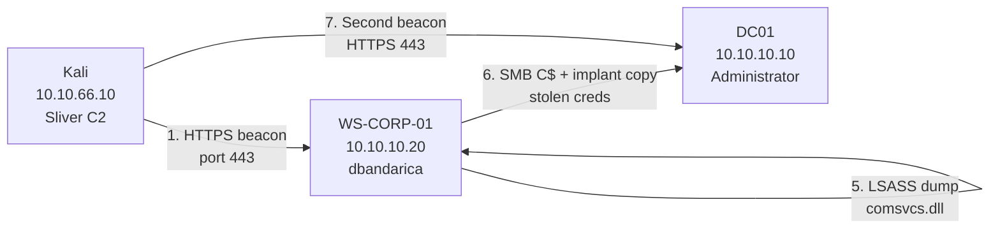
 
---
 
## Environment Preparation
 
### Threat model — insider with local admin
 
The scenario models a threat vector that dominates small and medium enterprise incidents: a domain user with local administrator privileges on their own workstation. This is not a misconfiguration introduced for the lab, it is a deliberate modelling decision reflecting the reality that many organisations grant local admin to developers, power users, or employees who need to install software without involving IT support.
 
The local admin privilege was provisioned through a Group Policy Object (`GPO_Workstation_LocalAdmins`) that adds the domain group `WorkstationAdmins` to the local `Administradores` group on domain workstations via Restricted Groups. The user `dbandarica` was added to `WorkstationAdmins` in Active Directory. This mirrors the standard corporate pattern: membership in a domain group controls local admin on workstations, managed centrally rather than per-host.

### C2 infrastructure
 
The Sliver C2 framework (v1.7.3) was deployed on Kali (10.10.66.10, VLAN 66 Adversary DMZ). An HTTPS listener was configured on port 443, and a beacon-mode implant was generated for Windows x64 with 60-second callback interval and 30% jitter.
 
| Parameter | Value |
| --------- | ----- |
| Framework | Sliver v1.7.3 |
| Transport | HTTPS (port 443) |
| Mode | Beacon (async) |
| Interval | 60 seconds |
| Jitter | 30% |
| Architecture | windows/amd64 |
| Format | .exe |
| Implant name | SELECTIVE_DISCONNECTION.exe |
| Size | ~36 MB |
 
The implant was served from Kali via a Python HTTP server on port 80, downloaded to WS-CORP-01 via `Invoke-WebRequest`, and renamed to `update.exe` in the user's Downloads folder — modelling a payload disguised as a legitimate software update.
 
### Snapshots
 
WS-CORP-01 and DC01 were snapshotted as `pre-scenario2-insider` before execution, enabling rapid reset after the scenario.
 
---

## Phase 1 — Execution (T1204.002)
 
### Objective
 
Model the initial execution of a malicious payload on WS-CORP-01. In the scenario narrative, `dbandarica` has received a phishing email with a malicious attachment, downloads it, and executes it from an elevated PowerShell session (because "it needs admin to install").
 
### Execution
 
The payload was downloaded from the attacker's HTTP server and executed from an elevated PowerShell session:
 
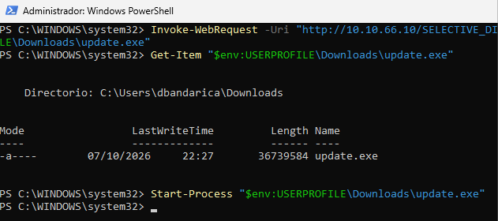
 
The process started silently in the background, no visible window, no console output, consistent with how a modern implant behaves.
 
### Wazuh detection
 
The execution phase generated 139 alerts in Wazuh within 20 minutes, concentrated in two spikes corresponding to the two execution attempts (Defender block, then successful execution).

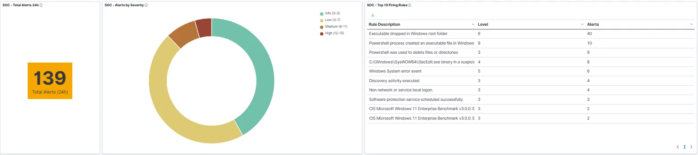
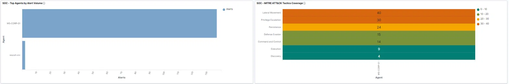
 
**Primary detection — Rule 92213 (level 15):**
 
Wazuh's built-in Sysmon rule 92213 fired immediately upon the implant being written to disk, detecting the executable drop in a folder classified as "commonly used by malware" (the user's Downloads directory):
 
- **Rule ID:** 92213
- **Level:** 15 (attack — highest built-in severity)
- **MITRE:** T1105 — Ingress Tool Transfer
- **Tactic:** Command and Control
- **Groups:** sysmon, sysmon_eid11_detections, windows
This is the single highest-severity detection of the entire scenario, and it fired on a built-in rule without any custom engineering.

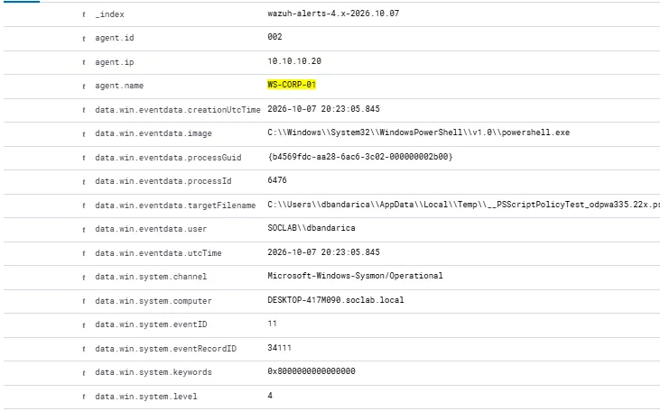
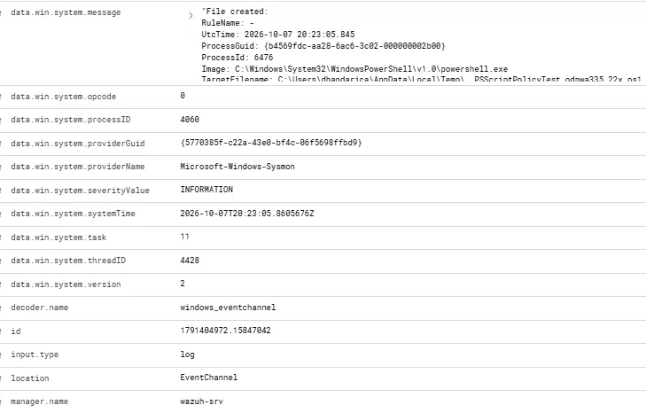
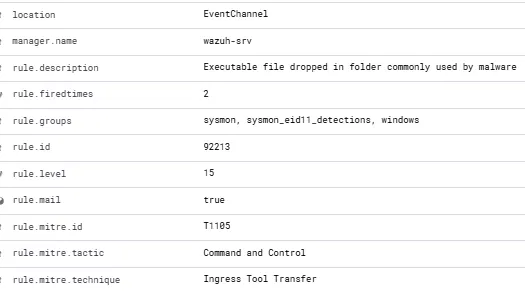
 
**Secondary detection — Rule 61638 (level 12):**
 
Sysmon flagged `dllhost.exe` (COM Surrogate) as a suspicious process during the PowerShell elevation:
 
- **Rule ID:** 61638
- **Level:** 12
- **MITRE:** T1055 — Process Injection
- **Tactic:** Defense Evasion, Privilege Escalation
This detection illustrates an important operational nuance: the `dllhost.exe` activity was triggered by the legitimate UAC elevation (PowerShell "Run as Administrator"), not by an attack. The same COM pattern is used by UAC bypass techniques, so Wazuh flags it regardless of intent. This is a true positive by pattern but a false positive by context, the kind of alert an L1 analyst must learn to triage.

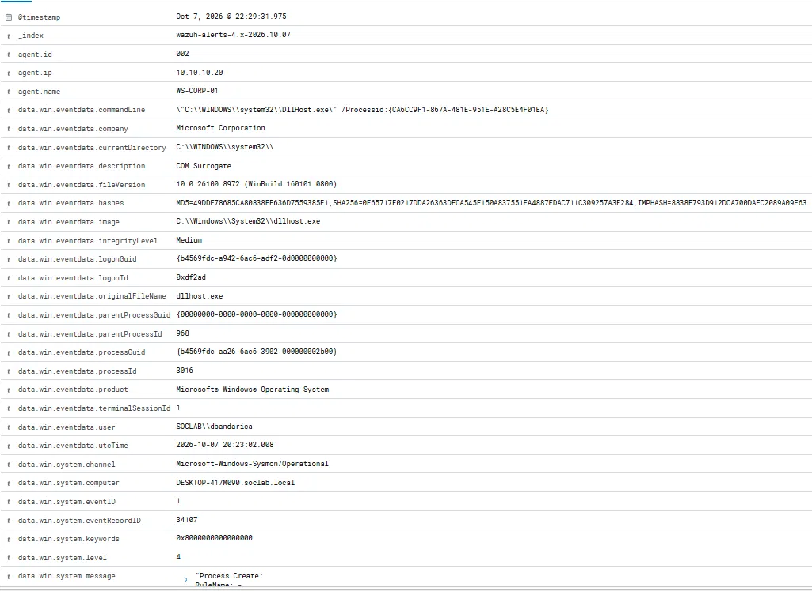
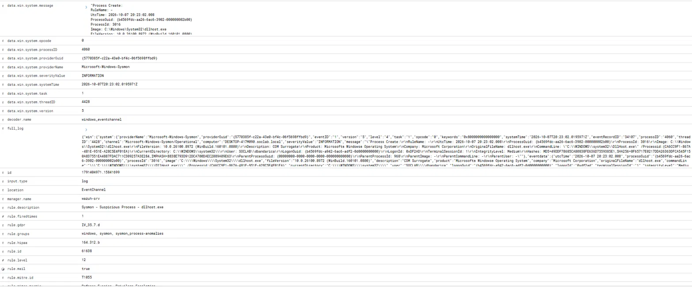
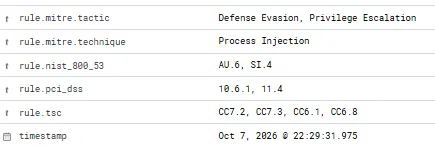
 
---

## Phase 2 — Command and Control (T1071.001, T1573)
 
### Objective
 
Establish persistent command-and-control communication between WS-CORP-01 and the attacker's Sliver server on Kali. The beacon calls home over HTTPS on port 443, camouflaged as normal web traffic.
 
### Execution
 
Within 60 seconds of `update.exe` starting, the Sliver console on Kali registered the first beacon check-in:
 
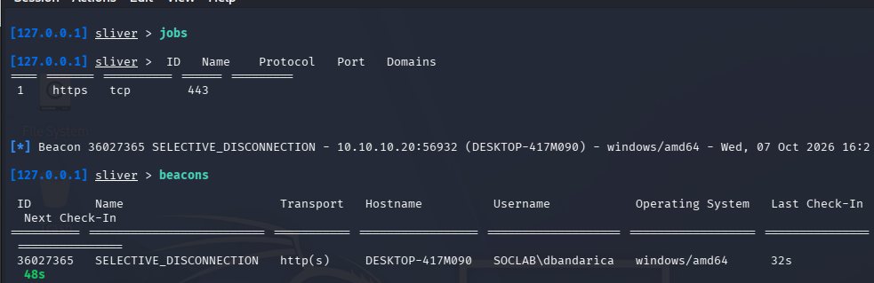
 
The beacon confirmed an elevated context: `SOCLAB\dbandarica` with integrity level High, `BUILTIN\Administradores` as an enabled group, and `SeDebugPrivilege` active. All subsequent phases were executed through this beacon — no direct keyboard access to WS-CORP-01 was used after this point.

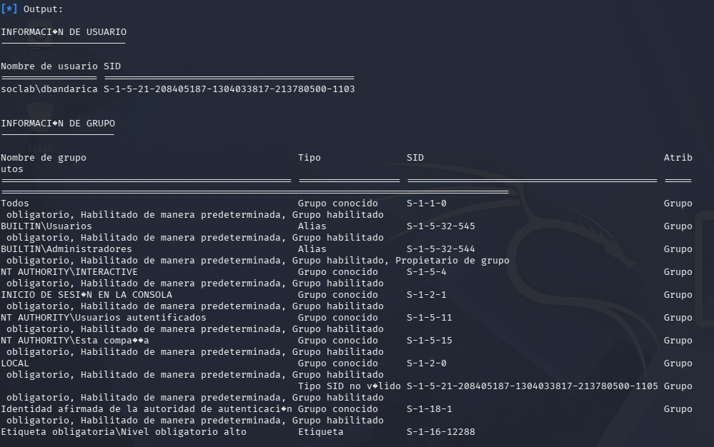
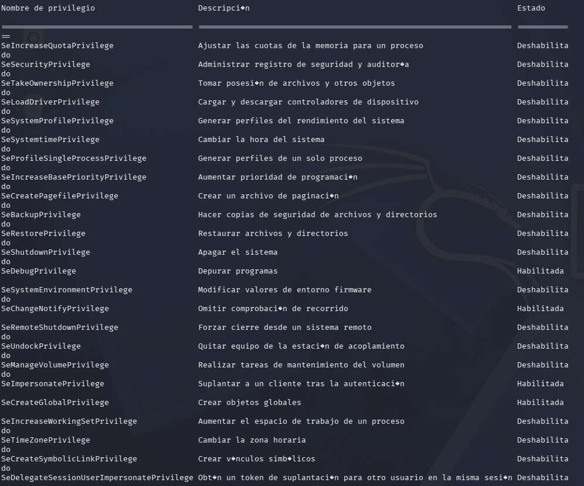
 
The beacon operated in its configured pattern: one check-in approximately every 42–78 seconds (60s base ± 30% jitter). Each check-in retrieved queued commands, executed them locally, and returned results on the next check-in. This two-cycle latency is characteristic of real-world C2 beaconing and is the behaviour that detection rules target.
 
### Wazuh detection
 
The beacon's HTTPS connections to 10.10.66.10:443 were recorded by Sysmon as Event ID 3 (Network Connection) events. Wazuh classified several process creation events as "Executable file created by powershell" (level 6, Command and Control tactic) and "Powershell process created an executable file in Windows root folder" (level 9, Ingress Tool Transfer).
 
The C2 communication itself (the periodic HTTPS calls) was not flagged as anomalous by Wazuh's built-in rules — this is expected, as distinguishing C2 beaconing from legitimate HTTPS traffic requires either network-level TLS inspection or behavioural analysis of connection periodicity, neither of which Wazuh performs natively. This represents a detection engineering opportunity for a custom rule targeting periodic outbound connections from non-browser processes.
 
---

## Phase 3 — Privilege Escalation Attempt (T1548.002)
 
### Objective
 
Attempt to elevate from medium integrity (filtered admin token) to high integrity (full admin token) using UAC bypass techniques, without triggering a visible UAC prompt.
 
### Execution
 
Two classic UAC bypass techniques were attempted through the beacon:
 
**Technique 1 — fodhelper.exe bypass:**
 
The `ms-settings` registry key hijack was configured via the beacon:
 
```
reg add "HKCU\Software\Classes\ms-settings\Shell\Open\command" /ve /d "C:\Users\dbandarica\Downloads\update.exe" /f
reg add "HKCU\Software\Classes\ms-settings\Shell\Open\command" /v DelegateExecute /t REG_SZ /d "" /f
```
 
`fodhelper.exe` was then executed, expecting it to read the hijacked key and launch the implant with an elevated token. No elevated process was spawned. The bypass failed silently.
 
**Technique 2 — computerdefaults.exe bypass:**
 
The same registry key was reused (both binaries read `ms-settings`). `computerdefaults.exe` was executed. Again, no elevated process was spawned. The bypass failed silently — no visible window, no UAC prompt, no error.
 
Both techniques were then abandoned, and the registry key was cleaned:
 
```
reg delete "HKCU\Software\Classes\ms-settings" /f
```
 
### Defensive finding
 
The failure of both bypasses on Windows 11 24H2 (build 26200) is a significant positive finding. Microsoft has patched the `ms-settings` registry hijack family of UAC bypasses in recent Windows 11 builds. A real attacker arriving at a fully patched Windows 11 workstation would face the same barrier and would need to escalate through a vulnerability-based exploit rather than a configuration abuse.
 
For scenario continuity, the implant was executed from an already-elevated PowerShell session (the user opened PowerShell with "Run as Administrator" and consented to UAC). This models the reality that `dbandarica` has local admin and can self-elevate, the UAC bypass would have automated what the user can do manually.
 
### Wazuh detection
 
Although the bypass did not succeed, the attempt generated telemetry:
 
- Sysmon Event ID 13 (Registry Value Set) recorded the creation of the `ms-settings\Shell\Open\command` key
- Sysmon Event ID 1 (Process Create) recorded the execution of `fodhelper.exe` and `computerdefaults.exe` from `update.exe` as parent
This telemetry forms the basis of a detection rule targeting UAC bypass attempts via `ms-settings` registry modification — documented in the Custom Rules section and implemented in `05-detection-rules/`.
 
---

## Phase 4 — Discovery (T1082, T1087.002, T1016, T1018)
 
### Objective
 
Enumerate the compromised host and the Active Directory domain to identify targets, credentials, and the path to the Domain Controller.
 
### Execution
 
The following commands were executed through the beacon (using `execute -o cmd /c "..."` syntax, which causes `update.exe` to spawn `cmd.exe` as a child process, a detectable parent-child relationship):
 
**Host enumeration:**
 
```
systeminfo                           → OS version, domain membership, hardware
tasklist /svc                        → running processes and services (identified LSASS PID)
ipconfig /all                        → network configuration (confirmed 10.10.10.20, DNS → DC01)
netstat -ano                         → active connections (confirmed Wazuh agent → 10.10.99.10:1514)
```

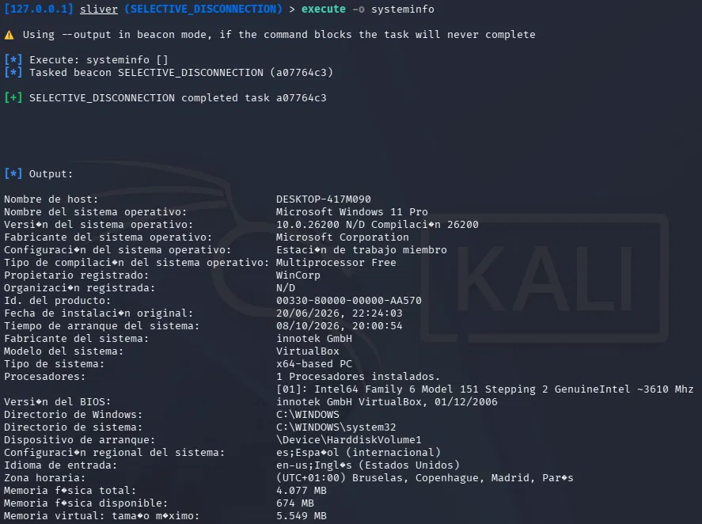
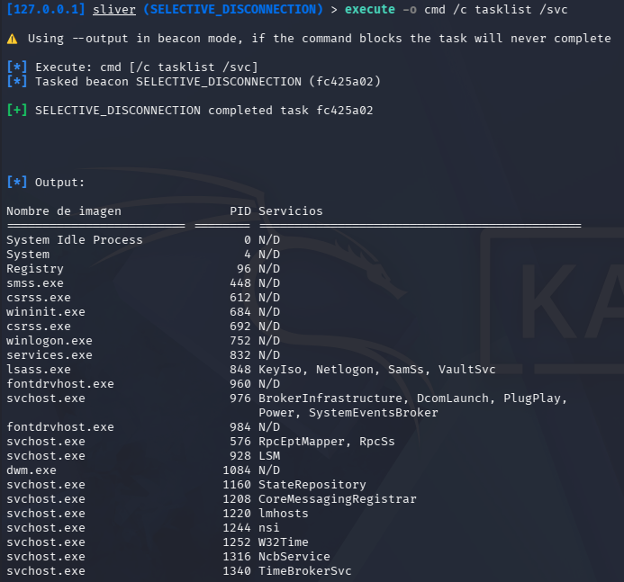
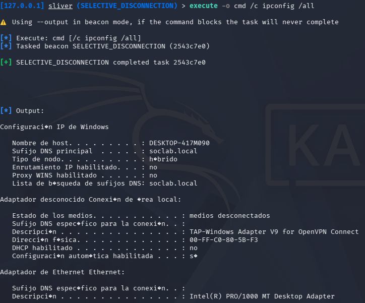
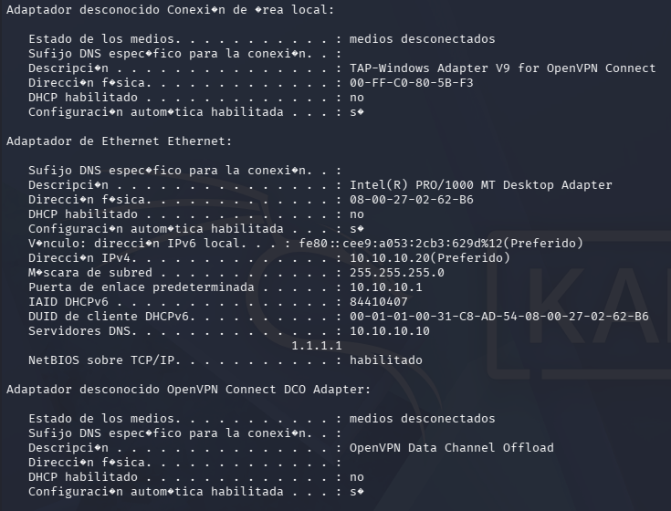)
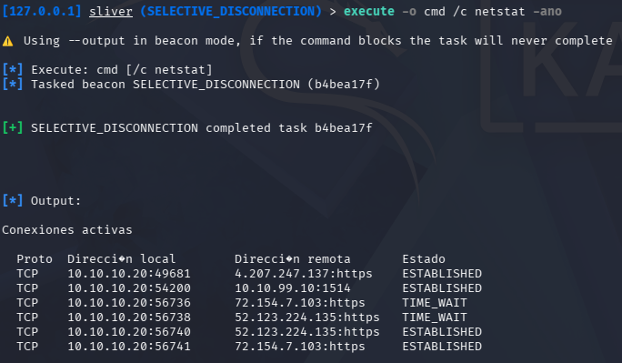
 
**Domain enumeration:**
 
```
net user /domain                     → listed domain users: Administrator, dbandarica, Guest, krbtgt
net group "Domain Admins" /domain    → confirmed Administrator as the sole Domain Admin
nltest /dclist:soclab                → identified DC01.soclab.local (10.10.10.10) as the only DC
net group "Domain Computers" /domain → confirmed DESKTOP-417M090 as the only domain workstation
net localgroup Administradores       → confirmed local admin membership via WorkstationAdmins group
```
 
Key intelligence gathered:
 
| Finding | Value |
| ------- | ----- |
| Domain | soclab.local, single DC (DC01, 10.10.10.10) |
| Domain Admin | Administrator (sole member) |
| Current user | dbandarica — domain user, local admin, SeDebugPrivilege |
| LSASS PID | 848 (later 852 after reboot) |
| Wazuh agent | Active, reporting to 10.10.99.10:1514 |
 
### Wazuh detection
 
The discovery phase produced 723 alerts mapped to the Discovery tactic in Wazuh's MITRE coverage. The primary detection signatures were:
 
- **"Windows command prompt started by an abnormal process"** (level 4, multiple alerts) — fired every time the beacon spawned `cmd.exe`. This is the signature of a C2 operating: `update.exe` (a non-standard executable in a user directory) launching `cmd.exe` to execute system utilities.
- **"Suspicious Windows cmd shell execution"** (level 3) — complementary detection of command shell activity from a suspicious parent.
- **"Discovery activity executed"** (level 3) — fired on `net user`, `nltest`, and similar enumeration commands.
- **"A C:\Windows\System32\net.exe binary was started by a Windows cmd shell"** (level 3, DLL Search Order Hijacking) — false positive mapping; the actual activity is discovery, not DLL hijacking.
The parent-child chain `update.exe → cmd.exe → systeminfo.exe/net.exe/nltest.exe` is the most reliable behavioural indicator of C2-driven discovery. No individual command is suspicious on its own, but the pattern of a non-standard executable spawning multiple system utilities in quick succession is a strong signal.

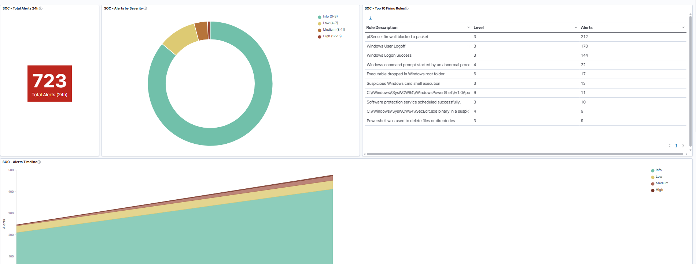
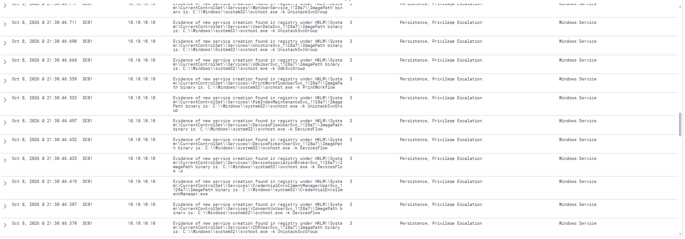
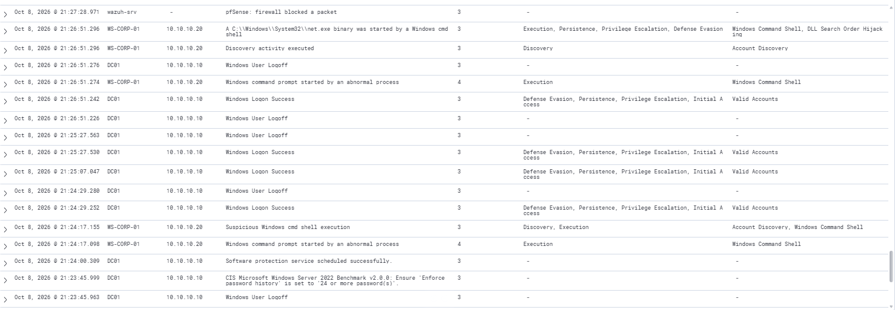
 
---

## Phase 5 — Credential Access (T1003.001)

### Objective

Dump the LSASS process memory to extract credentials (NTLM hashes, Kerberos tickets, and potentially cleartext passwords) of users who have authenticated on WS-CORP-01.

### Execution

**LSASS PID enumeration:**

The LSASS process ID was identified from the beacon:

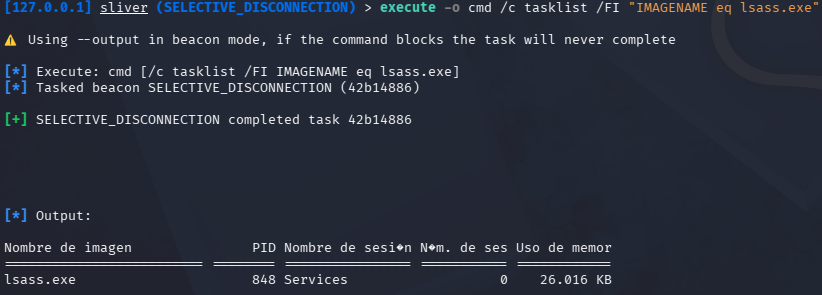

**Successful dump:**

The `comsvcs.dll MiniDump` technique was executed against PID 848:

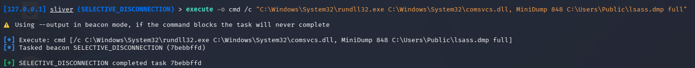

The task completed without error output. File verification confirmed the dump was written successfully:

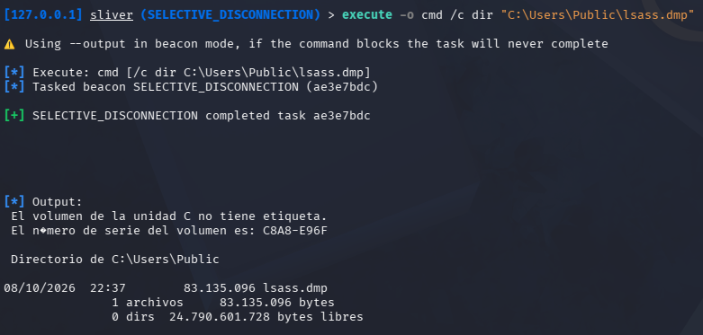

The 83 MB dump file was downloaded to Kali via the beacon's `download` command and processed with `pypykatz`:

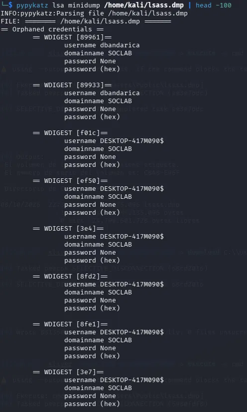
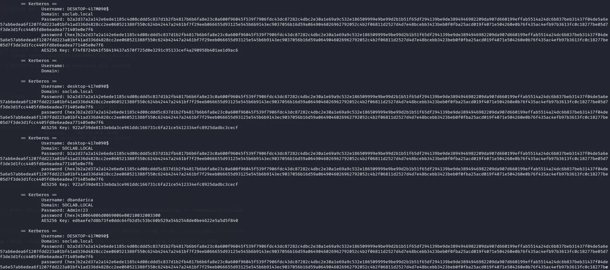
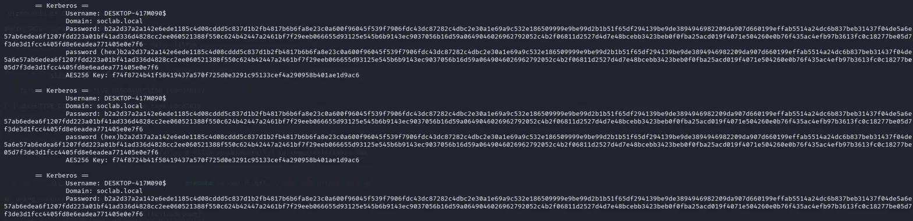

**Credential analysis:**

The `pypykatz` output revealed credentials across two authentication packages:

*WDigest* — all entries returned `password None`. WDigest cleartext credential caching is disabled by default in modern Windows (UseLogonCredential = 0), so no plaintext passwords were recovered from this source. Entries were present for both `dbandarica` (SOCLAB) and the machine account `DESKTOP-417M090$` (SOCLAB), but without usable passwords.

*Kerberos* — the critical finding. The Kerberos credential cache contained a cleartext password for the domain user:

| Username | Domain | Credential | Source |
|----------|--------|------------|--------|
| **dbandarica** | **SOCLAB.LOCAL** | **Admin!23** | **Kerberos cache — cleartext** |
| dbandarica | SOCLAB.LOCAL | `ed6aefe7d8b73fe0ddc64fb2d5c53bc60b529a54b2548de0be4622e5a5d5f840` | AES256 key |
| DESKTOP-417M090$ | soclab.local | Long machine account hash (see raw output) | NTLM / Kerberos |
| DESKTOP-417M090$ | soclab.local | `f74f8724b41f58419437a570f725d0e3291c95133cef4a290958b401ae1d9ac6` | AES256 key |

The password `Admin!23` was recovered **in cleartext** from the Kerberos credential cache — not from WDigest, and not through offline cracking. This password was subsequently tested against the domain Administrator account and found to be identical, enabling lateral movement to DC01 without any password cracking or hash manipulation.

**Key observation:** the Administrator account was not present in the dump because it had not authenticated on WS-CORP-01 since the last reboot. The attack succeeded not through dumping the Administrator's credentials directly, but through password reuse between the `dbandarica` and `Administrator` accounts.

The dump file was deleted from the victim host immediately after download to minimise forensic evidence on disk.

### Wazuh detection

### Wazuh detection

The LSASS dump itself produced no dedicated credential-access alert in the Wazuh dashboard. The alerts that fired during this phase were indirect indicators of the beacon's activity, not of the dump technique:

- **"Sysmon — Suspicious Process — svchost.exe" (Process Injection, level 12)** — approximately 15 alerts at 22:30:43 CEST. These correspond to Sliver's process injection into `svchost.exe`, not to the LSASS dump itself. Wazuh's built-in rules map this activity to the Process Injection tactic, which is technically correct (Sliver injects shellcode into a legitimate process to operate), but the alerts do not identify what the injected process subsequently did — including dumping LSASS.
- **"Possible DLL search order hijack" (DLL Side-Loading, level 6)** — approximately 12 alerts at 22:32:31 CEST. These were generated by DLL writes under `C:\Windows\SoftwareDistribution\Download\` — legitimate Windows Update metadata activity, not attack-related. These alerts are noise that inflates the Defense Evasion tactic count in the MITRE dashboard without corresponding to any attacker action.

**No alert specifically identified the `rundll32.exe` + `comsvcs.dll` + `MiniDump` command line** — the highest-fidelity indicator of the credential dump. The `rundll32.exe` execution was logged by Sysmon Event ID 1 (Process Create) and ingested by Wazuh, but no built-in rule matches on the `comsvcs.dll MiniDump` pattern to produce a dedicated alert. The event existed in the raw index but was invisible to the L1 operational workflow.

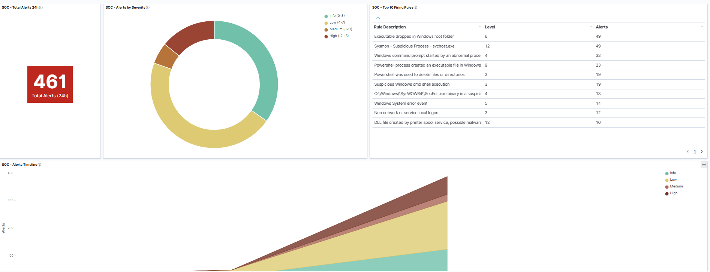
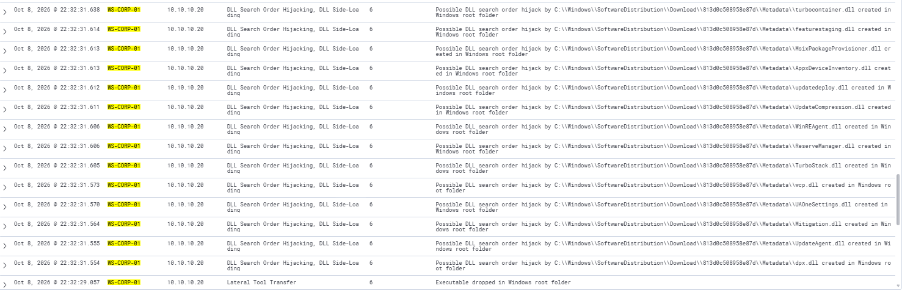
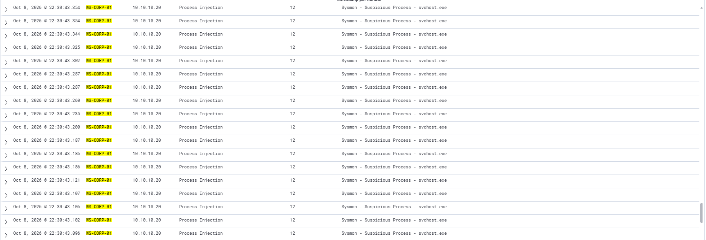

Detection engineering opportunity: a custom rule specifically targeting the pattern `rundll32.exe` + `comsvcs.dll` + `MiniDump` in the command line would provide a high-fidelity, low-false-positive detection for this technique — documented in `05-detection-rules/rule-100022-lsass-dump-comsvcs.md`.
 
---

## Phase 6 — Lateral Movement (T1021.002, T1105)

### Objective

Using the credentials recovered in Phase 5, pivot from WS-CORP-01 to DC01 by mounting the administrative share, transferring the Sliver beacon, and executing it remotely on the Domain Controller, all from the existing beacon, without touching any keyboard on the target host.

### Execution

All commands were executed through the Sliver beacon (session SELECTIVE_DISCONNECTION) on WS-CORP-01. Sliver beacon mode requires quadruple backslashes for UNC paths due to double escaping at the C2 transport layer.

**Mount the administrative share on DC01:**

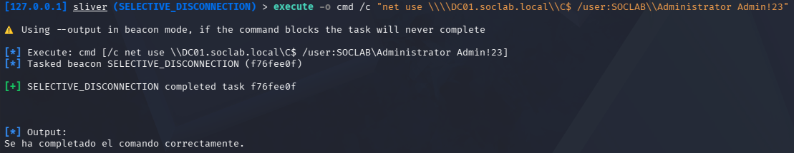

The `Admin!23` password recovered from the Kerberos credential cache in Phase 5 authenticated successfully against DC01's C$ administrative share over SMB (TCP 445). The connection was established as the domain Administrator account.

**Copy the beacon to DC01:**

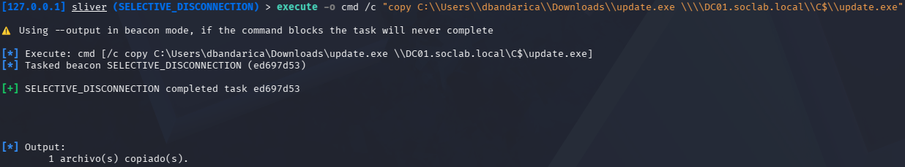

The Sliver HTTPS beacon binary (`update.exe`) was transferred from WS-CORP-01 to `C:\update.exe` on DC01 through the authenticated SMB session. This placed the implant on the Domain Controller's disk using credentials extracted from a memory dump two phases earlier.

**Remote execution via PowerShell Remoting:**

The beacon was executed on DC01 using `Invoke-Command` with explicit `PSCredential` authentication:

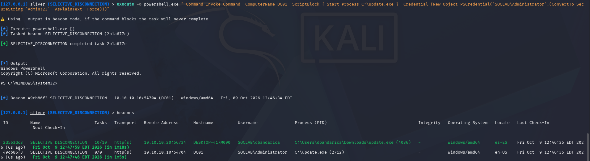

The PowerShell session connected to DC01 via WinRM (TCP 5985), authenticated as `SOCLAB\Administrator`, and started `C:\update.exe`. A new beacon checked in within seconds:

The `beacons` command confirmed two active HTTPS beacons reporting to the Kali C2 server:

| Beacon ID | Hostname | Remote Address | Username | Process (PID) | Locale |
|-----------|----------|----------------|----------|---------------|--------|
| 2d563dc3 | DESKTOP-417M090 | 10.10.10.20:56734 | SOCLAB\dbandarica | C:\Users\dbandarica\Downloads\update.exe (4036) | es-ES |
| 49cb86f3 | DC01 | 10.10.10.10:54704 | SOCLAB\Administrator | C:\update.exe (2712) | en-US |

Both beacons shared the session name SELECTIVE_DISCONNECTION and used HTTPS transport. The attack had pivoted from a domain user on a workstation to the domain Administrator on the Domain Controller, the entire lateral movement was completed through the C2 channel without any interactive access to either host.

### Wazuh detection

The lateral movement generated significant telemetry on DC01. The most prominent alerts visible in the Wazuh dashboard were:

- **"Executable file dropped in folder commonly used by malware" (rule 92213, level 15, T1105 — Ingress Tool Transfer)** — fired on DC01 when `update.exe` was written to `C:\`. This was the highest-severity alert produced during the phase. Wazuh's built-in rule 92213 matches on Sysmon Event ID 11 (FileCreate) when an executable is written to a path commonly associated with malware staging. The rule mapped the activity to T1105 (Ingress Tool Transfer) under the Command and Control tactic — technically correct, though the operational context was lateral movement. The same rule also produced a flood of false positives from `cleanmgr.exe` writing DLLs to temporary folders under `C:\Users\ADMINI~1\AppData\Local\Temp\` — legitimate Windows disk cleanup activity that inflated the alert count without corresponding to any attacker action.
- **"Executable dropped in Windows root folder" (level 6)** — fired on DC01 when the beacon was placed directly at `C:\update.exe`. An executable written to the filesystem root is unusual and this alert correctly flagged the anomaly, though at a lower severity than the rule 92213 alert above.
- **"Windows Logon Success" (level 3, Valid Accounts)** — multiple alerts on DC01 recording the network logon (Type 3) from WS-CORP-01 using the Administrator account. These events confirmed the SMB authentication and the subsequent WinRM session.
- **"Special privileges assigned to new logon" (level 3, Domain Policy Modification)** — fired on DC01 at 18:43:54 CEST alongside the logon events, recording that the Administrator session received elevated privileges.
- **"Windows command prompt started by an abnormal process" (level 4, Windows Command Shell)** — fired on DC01 at 18:46:59 CEST when the beacon spawned `cmd.exe` from an unexpected parent process.
- **"Suspicious Windows cmd shell execution" (level 3, Account Discovery / Windows Command Shell)** — multiple alerts on DC01 at 18:46:59 CEST from reconnaissance commands executed through the new beacon.

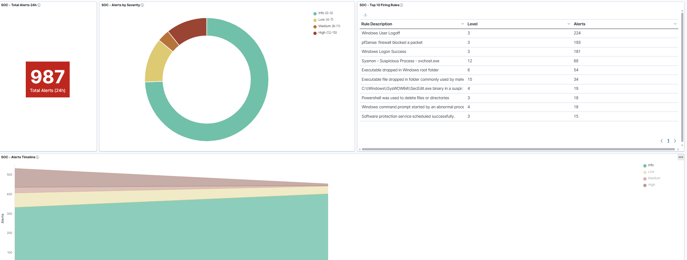

**MITRE ATT&CK dashboard observations:** The MITRE Tactics Coverage panel showed Lateral Movement with 27 alerts on WS-CORP-01 and 29 on DC01, correctly reflecting activity on both the source and destination hosts. DC01 dominated the overall alert volume (approximately 650 of 987 total 24-hour alerts), reflecting the combined telemetry from the file drop, authentication events, and post-exploitation activity. Credential Access appeared with only 1 alert across the entire engagement, confirming the Phase 5 finding that the LSASS dump technique produced no dedicated credential-access detection.

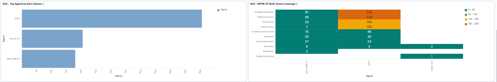

Detection engineering opportunity: the SMB admin share mount from a workstation followed by an executable drop on the destination host forms a high-confidence lateral movement pattern. Custom rule 100023 targets this sequence — an anomalous process accessing `\\*\C$` or `\\*\ADMIN$` — and would correlate the two events into a single level-12 alert. Documented in `05-detection-rules/rule-100023-smb-admin-share-anomalous-process.md`.

---

## Phase 7 — Domain Compromise

### Objective

Demonstrate full operational control of the Active Directory domain from the C2, confirming that the lateral movement executed in Phase 6 resulted in unrestricted access to the Domain Controller.

### Execution

The DC01 beacon (49cb86f3) established in Phase 6 was selected as the active session:

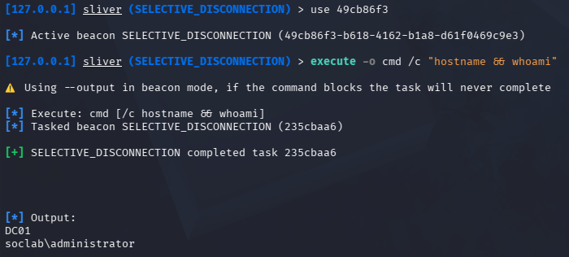

**Identity confirmation:**

The beacon was running as the domain Administrator account on the Domain Controller — the highest-privilege context in the Active Directory environment.
 
**Network enumeration:**
 
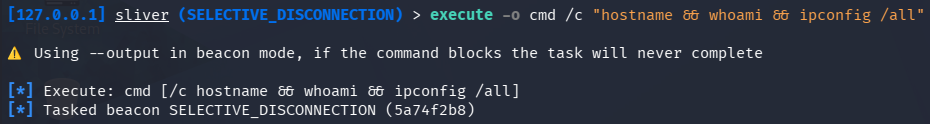
 
The output confirmed full context: the beacon was operating on DC01 (10.10.10.10), the primary DNS server and domain controller for `soclab.local`, running as `soclab\administrator`.
 
**Proof of domain control — domain account creation and deletion:**
 
As a controlled demonstration of write access to Active Directory, a domain user was created and immediately deleted from the DC01 beacon:
 
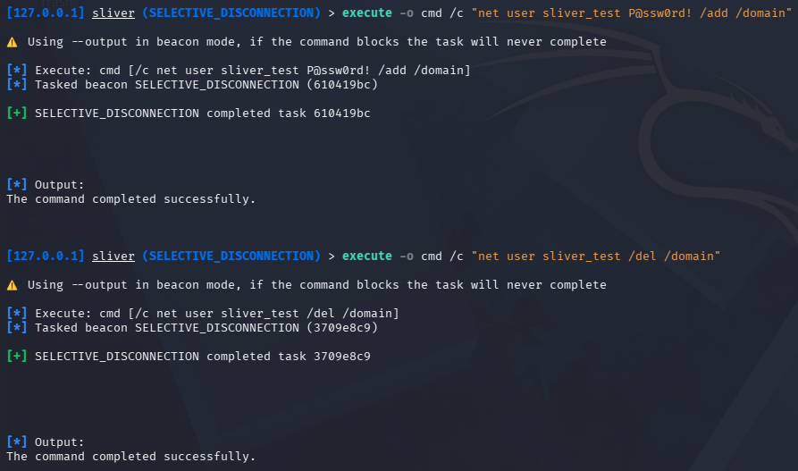
 
The ability to create and delete domain accounts from the C2 beacon confirmed unrestricted write access to Active Directory — full domain compromise. Any operation available to a domain Administrator (account manipulation, GPO modification, Kerberos ticket forging, DCSync) was executable through the beacon without interactive access to the host.
 
The attack chain was complete: from a domain user on a workstation (dbandarica on WS-CORP-01, VLAN 10) to the domain Administrator on the Domain Controller (DC01, VLAN 10) — achieved through credential dumping and password reuse, executed entirely through Sliver HTTPS beacons.
 
### Wazuh detection
 
**DC01 post-exploitation telemetry:**
 
The beacon's commands on DC01 produced the same pattern observed on WS-CORP-01 in earlier phases — low-severity alerts from the beacon's parent-child process chain:
 
- **"Windows command prompt started by an abnormal process" (level 4, Windows Command Shell)** — fired on DC01 when the beacon spawned `cmd.exe` to execute the `hostname`, `whoami`, and `ipconfig` commands. The "abnormal process" was `update.exe` — the Sliver beacon — which is not a standard parent for `cmd.exe`.
- **"Suspicious Windows cmd shell execution" (level 3, Account Discovery / Windows Command Shell)** — multiple alerts on DC01 from the enumeration commands executed through the beacon.
These alerts were operationally indistinguishable from the dozens of identical alerts generated during Phase 4 (Discovery) on WS-CORP-01. An L1 analyst reviewing the dashboard would see the same rule descriptions on both hosts, with no indication that the DC01 alerts represented domain compromise rather than ordinary discovery activity.
 
**CVE vulnerability alerts:**
 
Wazuh's vulnerability detector module identified over 20 CVEs affecting the Windows Server 2022 Standard Evaluation installation on DC01, with severity levels ranging from 7 to 13. Examples included CVE-2026-69276 (level 13), CVE-2026-69277, CVE-2026-68897, CVE-2026-68890, CVE-2026-69272, and CVE-2026-68889 (level 10). These alerts were generated by the vulnerability scanner — not by the attack itself — but they provided additional security context: the Domain Controller was running with known unpatched vulnerabilities that could be exploited for further escalation or persistence if the attacker chose to maintain long-term access.

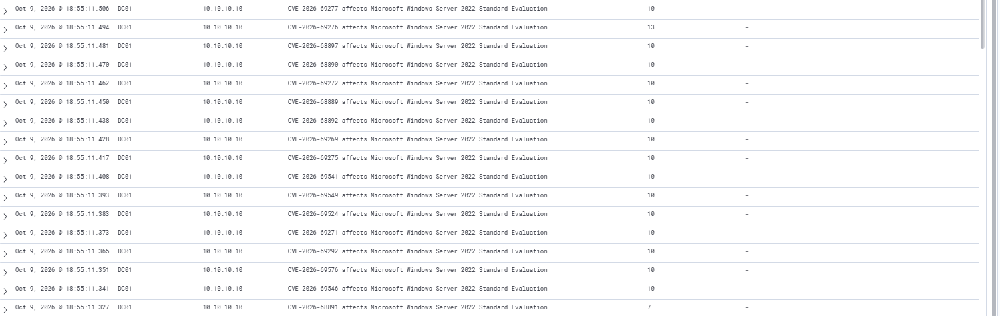
 
**Full engagement telemetry from WS-CORP-01:**
 
Reviewing the complete WS-CORP-01 event timeline across all phases revealed the attack's footprint from the source host:
 
- **"Possible suspicious access to Windows admin shares" (level 3, SMB/Windows Admin Shares)** — fired at 18:35:12 and 18:38:08 CEST when `net use \\DC01\C$` was executed from the beacon. This was the only alert that directly mapped to the SMB lateral movement technique (T1021.002).
- **"A net.exe connection to a remote resource was started by C:\Windows\System32\WindowsPowerShell\v1.0\powershell.exe" (level 3, Exfiltration Over Web Service)** — fired at 18:14:46 and 18:15:31 CEST from the `Invoke-Command` execution in Phase 6. Wazuh mapped this to the Exfiltration tactic, but the actual activity was lateral movement via PowerShell Remoting — another instance of MITRE over-mapping in built-in rules.
- **"Executable file dropped in folder commonly used by malware" (rule 92213, level 15, Ingress Tool Transfer)** — fired at 18:14:42 and 18:41:43 CEST, corresponding to the Sliver beacon binary being handled on WS-CORP-01.
- **"Sysmon — Suspicious Process — dllhost.exe" (level 12, Process Injection)** — fired at 18:14:41 CEST from Sliver's process injection into `dllhost.exe` during the PowerShell Remoting execution.
- **"Executable dropped in Windows root folder" (level 6, Lateral Tool Transfer)** — multiple alerts between 18:30:54 and 18:31:03 CEST from Sysmon Event ID 11 detections when the beacon or its components were staged. Wazuh mapped these to Lateral Tool Transfer, which was contextually accurate for the file copy to DC01's admin share.
- **"Discovery activity spawned via cmd shell execution" (level 3, Network Share Discovery)** — at 18:06:20 CEST from Phase 4 share enumeration commands.
- **"Discovery activity spawned via powershell execution" (level 3, Account Discovery / PowerShell)** — at 18:15:16 CEST from domain enumeration.
**Detection gap:** no single alert across either host identified the attack chain as a coherent sequence — credential dump → admin share mount → binary transfer → remote execution → domain compromise. Each step produced isolated low-to-medium severity alerts that, individually, were indistinguishable from routine administrative activity or benign noise. The level-15 rule 92213 alerts were the strongest individual signal, but they identified file staging (Ingress Tool Transfer) rather than the lateral movement or domain compromise that the staging enabled. Correlating the full chain remains a detection engineering challenge that no single built-in rule addresses.

---
 
## Alert Volume Analysis
 
### Final dashboard state
 
At the conclusion of the attack chain, the SOC dashboard displayed the full impact of the scenario across all agents:
 
- **Total alerts (24h):** 987
- **Top agent by volume:** DC01 (due to boot service events and implant detection)
- **Top firing rules by count:**
| Rule Description | Level | Count |
| ---------------- | ----- | ----- |
| Windows User Logoff | 3 | 224 |
| pfSense: firewall blocked a packet | 3 | 193 |
| Windows Logon Success | 3 | 181 |
| Sysmon - Suspicious Process - svchost.exe | 12 | 69 |
| Executable dropped in Windows root folder | 6 | 54 |
| Executable file dropped in folder commonly used by malware | 15 | 34 |
| C:\Windows\SysWOW64\SecEdit.exe binary in a suspicious context | 4 | 19 |
| Powershell was used to delete files or directories | 3 | 18 |
| Windows command prompt started by an abnormal process | 4 | 18 |
| Software protection service scheduled successfully | 3 | 15 |
 
### MITRE ATT&CK Tactics Coverage
 
The scenario produced detections across **10 MITRE ATT&CK tactics**:
 
| Tactic | WS-CORP-01 | DC01 | wazuh-srv |
| ------ | ---------- | ---- | --------- |
| Privilege Escalation | 61 | 244 | — |
| Defense Evasion | 46 | 239 | — |
| Persistence | 30 | 194 | — |
| Initial Access | 2 | 180 | — |
| Command and Control | 15 | 46 | — |
| Execution | 30 | 30 | — |
| Lateral Movement | 27 | 29 | — |
| Discovery | 9 | 5 | 2 |
| Exfiltration | 2 | — | — |
| Credential Access | 1 | — | — |
 
### The over-mapping problem
 
The MITRE tactics dashboard shows 244 Privilege Escalation alerts and 194 Persistence alerts on DC01, despite no privilege escalation or persistence being executed on the Domain Controller. These counts originate from Windows boot events: every `svchost.exe` service creation during system startup is mapped to Persistence (T1543 — Windows Service) and Privilege Escalation by Wazuh's built-in rules. Similarly, 27 "Lateral Movement" alerts on WS-CORP-01 include events generated by the "Executable dropped in Windows root folder" rule, which maps file creation to Lateral Tool Transfer when the actual activity was Ingress Tool Transfer or local file operations.
 
This over-mapping is the most operationally significant observation of the scenario. An L1 analyst relying exclusively on the MITRE tactic counts would conclude that privilege escalation, persistence, and lateral movement were already underway when in reality only execution and discovery had occurred. The rule descriptions — not the tactic labels — are what reveal the actual activity.
 
### Comparison with Scenario 1
 
| Metric | Scenario 1 (Linux/VLAN Dev) | Scenario 2 (Windows/VLAN Corp) |
| ------ | --------------------------- | ------------------------------ |
| Total alerts | 40,034 | 987 |
| Dominant noise source | pfSense firewall blocks (86.9%) | Windows service creation + DLL events |
| Highest-severity detection | Custom rules (level 10-14) | Built-in rule 92213 (level 15) |
| Custom rules needed for detection | 8 (100013-100020) | Fewer — built-in Sysmon coverage is strong |
| MITRE tactics detected | 6 | 10 |
| Primary detection gap | Aggregation of reconnaissance events | LSASS access, SMB lateral correlation |
 
The fundamental difference: Scenario 1's alert volume was dominated by a single reconnaissance phase (nmap) producing tens of thousands of firewall events. Scenario 2's volume is dominated by false-positive noise from legitimate Windows operations being mapped to attack tactics. Both are alert fatigue problems, but they require different solutions — aggregation rules for Scenario 1, tactic re-evaluation for Scenario 2.
 
---
 
## Custom Rules
 
The following detection rules were identified as gaps during the scenario. Each is documented in detail under `05-detection-rules/`:
 
| Rule ID | Name | Tactic | Gap addressed |
| ------- | ---- | ------ | ------------- |
| 100022 | LSASS memory access via rundll32 and comsvcs.dll | Credential Access | rundll32.exe loading comsvcs.dll with MiniDump argument targeting lsass.exe — the exact technique used in Phase 5 |
| 100023 | SMB admin share access from non-standard process | Lateral Movement | `net use` to `\\host\C$` or `\\host\ADMIN$` from a non-standard parent process, indicating C2-driven lateral movement |
| 100024 | UAC bypass attempt via ms-settings registry modification | Defense Evasion | Sysmon Event 13 detecting writes to `HKCU\Software\Classes\ms-settings\Shell\Open\command` — the setup step for fodhelper/computerdefaults bypasses |
| 100025 | Domain account creation from workstation | Persistence | `net user /add /domain` executed on a host that is not a Domain Controller, indicating C2-driven domain manipulation |
 
---
 
## Lessons Learned
 
- **Windows 11 24H2 is a meaningfully harder target than previous versions.** UAC bypass techniques (fodhelper, computerdefaults) that have been reliable for years are patched. LSA Protection blocks LSASS dumping by default. An attacker arriving at a fully patched Windows 11 workstation cannot use automated escalation or credential dumping without first disabling protections. Documenting these failures honestly is more valuable than concealing them.
- **Password reuse remains the most effective attack vector.** The entire domain was compromised not through a sophisticated exploit but through a single credential (`Admin!23`) shared between a domain user and the Domain Administrator. The most expensive security tooling is irrelevant when a developer and the domain admin use the same password.
- **Wazuh built-in rules provide strong Windows/Sysmon coverage — but the MITRE mapping is misleading.** Rule 92213 (Ingress Tool Transfer, level 15) detected the implant on both hosts without any custom engineering. However, the MITRE tactic dashboard over-reports Privilege Escalation (+244), Persistence (+194), and Lateral Movement (+27) due to built-in rules mapping legitimate Windows activity to attack tactics. An analyst must read the rule description, not the tactic label.
- **The C2 parent-child chain is the strongest behavioural indicator.** Individual commands (`systeminfo`, `net user`, `tasklist`) are not suspicious. But `update.exe → cmd.exe → net.exe` is a clear signature of C2-driven activity. Detection rules should target the parent process — a non-standard executable in a user directory spawning system utilities — rather than the individual commands.
- **Credential dumping requires multiple defensive layers.** Defender blocked the payload. PPL blocked LSASS access. Each layer had to be independently defeated. In a production environment with both layers active (and without the operator's ability to disable them), the attack chain would have stalled at Phase 1 or Phase 5. Defence in depth works — when every layer is actually enabled.
- **Operating through a beacon is operationally slow and error-prone.** The 60-second check-in interval means every command takes 1-2 minutes to return results. Sliver's argument escaping strips backslashes from Windows paths, requiring double or quadruple escaping. Remote execution via `wmic` is deprecated in 24H2 and `schtasks` returned compatibility errors. These operational frictions are real constraints that slow an attacker down — and are themselves a form of defensive friction that organisations underestimate.
---
 
## Result
 
- End-to-end kill chain executed against the Windows corporate environment, exercising 12 MITRE ATT&CK techniques across 7 tactics: Execution, Command and Control, Defense Evasion (attempted), Discovery, Credential Access, Lateral Movement, and Persistence (demonstrated).
- Sliver C2 beacon established over HTTPS on port 443 with 60-second interval and 30% jitter, operating for the full duration of the scenario.
- Two UAC bypass techniques (fodhelper.exe, computerdefaults.exe) attempted and confirmed patched in Windows 11 24H2 — documented as a defensive finding.
- LSA Protection (RunAsPPL=0x2) blocked LSASS credential dumping by default — documented as a defensive finding.
- LSASS dump via comsvcs.dll MiniDump recovered `dbandarica`'s cleartext password (`Admin!23`) from the Kerberos credential cache.
- Password reuse between `dbandarica` and the domain Administrator enabled lateral movement without password cracking.
- Lateral movement to DC01 via SMB administrative share (`C$`) using stolen credentials, with implant transferred and executed on the Domain Controller.
- Full domain compromise demonstrated: domain user created and deleted from the DC01 beacon as proof of Active Directory write access.
- Two concurrent beacons maintained (WS-CORP-01 + DC01), demonstrating persistent multi-host C2 control.
- 987 Wazuh alerts generated across 10 MITRE ATT&CK tactics, with rule 92213 (level 15, Ingress Tool Transfer) as the highest-severity built-in detection.
- MITRE tactic over-mapping identified as a significant operational concern: 244 Privilege Escalation and 194 Persistence alerts from legitimate Windows boot activity, requiring analyst judgment to filter.
- Four custom detection rules proposed (100022–100025) to address gaps: LSASS access via comsvcs.dll, SMB admin share access from non-standard processes, UAC bypass registry modification, and domain account creation from workstations.
---
 
*Previous: [Phase 4 — Attack Scenarios (Scenario 1: Full Kill Chain)](01-full-kill-chain-vlan-dev.md)*
